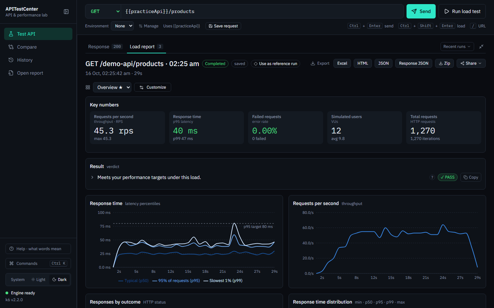

<h1 align="center">APITestCenter</h1>

<b>Load testing you can actually read.</b> 
Send a request, run a load test, and get a plain-language answer: is your API fast enough, and will it hold up?

  <a href="https://github.com/apitestcenter/apitestcenter/releases/latest/download/APITestCenter-Setup.exe"><b>Download for Windows</b></a> ·
  <a href="https://apitestcenter.com">Website</a> ·
  <a href="https://github.com/apitestcenter/apitestcenter/issues">Report a bug or ask for a feature</a>

## What it does

- **Answers in plain words** — "Meets your goals under this load", with the detail one click away.
- **Send and load test in one place** — paste a URL or curl command, check it, then run it with hundreds of simulated users.
- **Reports you arrange yourself** — 20 charts and numbers; drag, resize, and save your own views.
- **Real-world tests** — sign in first and reuse the token, test data from CSV, pass/fail goals, response checks.
- **Track change** — every run is kept; compare against a reference run or compare APIs side by side.
- **Private by design** — runs on your computer, reaches localhost and internal APIs, results are files you own.

Free for Windows 10 and 11. No account. macOS and Linux are planned.

## About this repository

This repository holds the [website](https://apitestcenter.com) and the **downloads** (see [Releases](https://github.com/apitestcenter/apitestcenter/releases)). Use [Issues](https://github.com/apitestcenter/apitestcenter/issues) for bugs and ideas, or email hello@apitestcenter.com.

APITestCenter is free to use under its [terms of use](https://github.com/apitestcenter/apitestcenter/releases/latest/download/LICENSE.txt). It includes open-source software, including [k6](https://github.com/grafana/k6) (AGPL-3.0); see the third-party notices attached to each release.

© 2026 Ratul Roy. All rights reserved.
